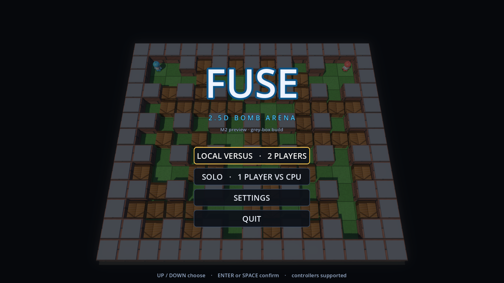
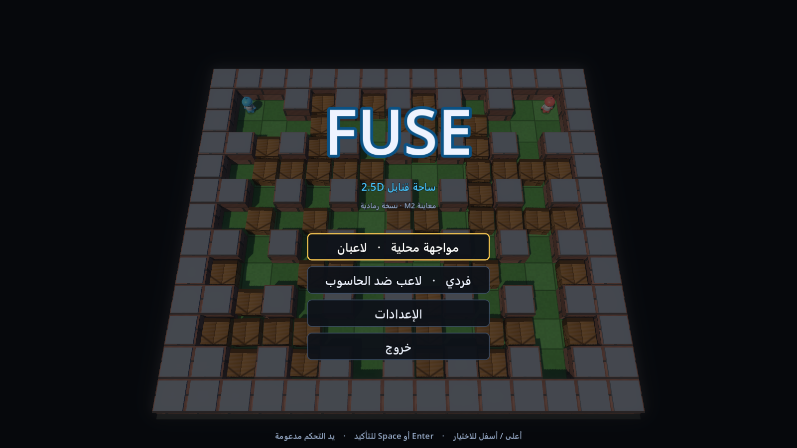
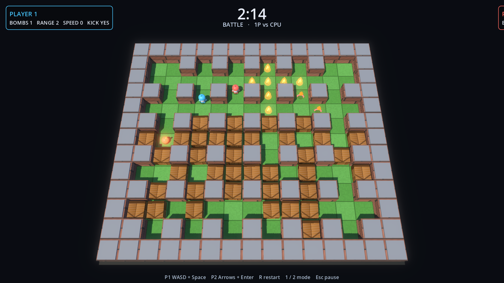

# FUSE

Working title for a modern **2.5D bomb-arena action game** (Atomic Bomberman-inspired),
built in **Godot 4.7.2**. Windows first, Android after.

> **Status: M2.9 — per-round arena variation, full-screen art pass, touch/web preview (verified).**
> Title screen with a live AI attract match → mode select → best-of series → results →
> rematch. Pause menu, persisted settings, and event-driven procedural sound effects are
> in. **Arabic and English ship from day one**, with RTL layout and a bundled
> Arabic-capable font. Every round of a series and every rematch gets its own **21×13
> arena**: grass checkerboard, terracotta brick pillars, a dense crate field, white-suited
> characters with coloured helmets, glossy black bombs and layered fire. The board fills
> the 16:9 frame. Movement reverses instantly, input presses are latched per event and bombs are
> buffered for 100 ms. A **single-threaded Web export** adds on-screen touch pads for
> phones, served over the local network in a landscape layout; it is a preview, not a
> public deployment. All art is still **code-built 3D primitives and shaders** — no
> external models or textures, and no music yet.
> See [`docs/PROGRESS.md`](docs/PROGRESS.md) for exactly what exists and what does not.



*Real captured frame from `--capture` mode — English title panel over a running AI attract
match.*



*The same screen in Arabic: translated strings and a right-to-left menu column.*



*Real captured frame from `--shot` mode, tick 779: two fighters, an armed bomb, fire and
pickups on the green checkerboard of the 21×13 arena.*

---

## Requirements

- Godot **4.7.2** (standard build, not .NET)
- Windows 10/11 for development
- Blender 4.x only when working on real art (not needed until M3)

The engine used by this project is installed at:

```
%LOCALAPPDATA%\Programs\Godot\4.7.2\Godot_v4.7.2-stable_win64.exe
```

Use the **console** executable for command-line work:

```
%LOCALAPPDATA%\Programs\Godot\4.7.2\Godot_v4.7.2-stable_win64_console.exe
```

The GUI executable does not attach stdout or return exit codes to PowerShell, which
breaks test automation.

## Play

```powershell
cd "C:\Users\ALMASA\OneDrive\Documents\Default Project\fuse"
& "$env:LOCALAPPDATA\Programs\Godot\4.7.2\Godot_v4.7.2-stable_win64.exe" --path .
```

The game boots to the title screen; an AI-vs-AI match plays behind the menu as an
attract demo. Menus are fully keyboard and controller navigable.

### Play on a phone (local web build)

The Web export is **single-threaded** and uses the **Compatibility** renderer, so it runs
from plain HTTP on a phone browser without cross-origin isolation headers.

```powershell
# one-time: export (requires the export templates for Godot 4.7.2)
& $godot --headless --path . --export-release "Web" build/web/index.html

# every session: serve build/web on the LAN
node tools/serve_web.mjs --port 8080
```

The server prints a LAN URL such as `http://192.168.1.20:8080/`. Open it on a phone that
is on the same Wi-Fi or hotspot. In a live 1P match the game shows a d-pad, a BOMB button
and a PAUSE button; the camera, HUD and pads are designed for landscape, so a portrait
phone shows a rotate prompt instead. Touch input writes into the same `InputRouter`
virtual slots as the keyboard, so buffering and rules are unchanged. Add `?touch=1` to
force the pads on in a desktop browser.

The host must allow inbound TCP 8080 through Windows Firewall (Windows prompts the first
time Node listens). This is a LAN preview only: there is no hosted server, no TLS and no
online play yet.

### Language

The interface ships in **English and Arabic** from day one. Settings exposes a language
row; the choice is persisted in `user://settings.json` and applied immediately, including
right-to-left layout for Arabic. Fonts are bundled under `assets/fonts/` (Noto Sans plus
Noto Sans Arabic, both OFL) so no system font is required. Add `--locale=ar` (or `--locale=en`)
after `--` to force a locale for captures and tests.

### Menus

| Input | Action |
| --- | --- |
| `Up` / `Down` (or D-pad) | Move selection |
| `Left` / `Right` | Adjust a volume slider |
| `Enter` / `Space` (or `A`) | Confirm |
| `Esc` | Leave settings / pause |

Title actions: **LOCAL VERSUS** (2 players, one keyboard or two pads), **SOLO**
(1 player vs CPU), **SETTINGS**, **QUIT**.

### Match

| Input | Action |
| --- | --- |
| `W A S D` + `Space` | Player 1 move / drop bomb |
| Arrow keys + `Enter` | Player 2 move / drop bomb |
| Gamepad left stick or D-pad + `A`/`X` | Player 1 or 2 (pad order) |
| `1` / `2` | One player vs CPU / two players local (restarts the series) |
| `R` | Restart the current round |
| `Esc` | Pause menu (resume / restart round / quit to title) |

A series is **best of 3** by default (1 or 5 selectable in settings). Draws award no
point but consume a round, and the round limit closes a series that cannot be decided.
**Every round and every rematch regenerates the arena** from a seed derived from the base
seed plus the series/round counters; `R` restarts the same round on the same board.

### Feel and input

- Base movement is **3.75 tiles/s** (16 ticks per tile), with five speed upgrades up to
  ≈6.1 tiles/s.
- Pressing the opposite direction **reverses in place** instead of finishing the tile
  first; reversing into a bomb is refused.
- Press edges are latched from the actual input event, so a quick tap is never lost
  between simulation ticks.
- A bomb press stays **buffered for 100 ms** and also carries from READY into GO, so
  presses just before a slot frees still land.
- Analog sticks use a 0.28 deadzone and follow the most-deflected axis.

The CPU opponent reads the same public simulation state a client sees and issues
ordinary move/bomb commands. It plans timed escape routes, so it will not walk along
its own blast lane.

## Settings and audio

**SETTINGS** lives on the title screen:

- master volume and SFX volume (applied live, persisted)
- language (English / العربية)
- series length (best of 1 / 3 / 5)
- fullscreen toggle
- values are stored in `user://settings.json`

The loader treats the file as untrusted: missing keys fall back to defaults, volumes are
clamped to `0..1`, unsupported series lengths and unknown locales are ignored, and
corrupt JSON is discarded rather than crashing the game.

All sound is **synthesised at runtime** (`src/audio/sfx_library.gd`) — placement thud,
crate break, explosion, pickup chime, hit and win jingle — and played through a 16-voice
pool driven by simulation events. There are no audio files and no music track yet; M3
replaces the placeholders with designed sound while keeping the event wiring.

## Art

The arena is drawn entirely by code — no imported models or textures yet:

- a single world-space slab shader paints the **green grass checkerboard** with dark tile
  seams, per-tile tone jitter and grass speckle;
- brick and timber shaders supply the **terracotta pillars** and **wooden crates**;
- fighters are white-suited characters with coloured helmets, gloves and boots, blinking
  eyes, an antenna, and procedural walk bob, lean, arm swing and squash;
- bombs are glossy black spheres with an angled animated fuse; explosions layer additive
  flame cones, ground glow and orbiting licks; pickups are emissive icons on rings.

The 68° camera and the stone-capped walls are tuned so the board reads top-down like the
classic games. Every screenshot in this README is a real capture from the running build.

## Run the tests

```powershell
cd "C:\Users\ALMASA\OneDrive\Documents\Default Project\fuse"
$godot = "$env:LOCALAPPDATA\Programs\Godot\4.7.2\Godot_v4.7.2-stable_win64_console.exe"
& $godot --headless --path . --script res://tests/run_tests.gd
```

Expected: `81 test(s), 647 assertion(s), 0 failure(s)` then `PASS` and exit code `0`.
Add `-- --verbose` to list each test by name.

End-to-end menu test (real scene tree, synthesized key events, real AI matches to a
finished series):

```powershell
& $godot --headless --path . --script res://tools/ui_flow_test.gd
```

Expected: `UI flow: 56 check(s)`, `PASS`, exit code `0`. It covers title → settings
(volume + series changes, plus ESC-to-close), title → 1P match, pause/resume, a genuine
AI-decided round, round 2, a decided series, rematch, and quit back to title.

Frame smoke test (boots the real scene for 300 frames, no errors allowed):

```powershell
& $godot --headless --path . --quit-after 300
```

Architecture guard (fails if `src/core` ever touches nodes, input, audio or the clock):

```powershell
powershell -ExecutionPolicy Bypass -File tools/check_core_boundaries.ps1
```

AI self-play smoke test (proves a match actually resolves; prints bombs, explosions,
crates, pickups, eliminations):

```powershell
& $godot --headless --path . --script res://tools/ai_selfplay.gd
# optional diagnostics:  ... --script res://tools/ai_selfplay.gd -- trace
```

## Screenshots

Shot mode fast-forwards a seeded AI-vs-AI match, waits for a frame that contains
bombs, fire and at least two living fighters, then writes a PNG and quits:

```powershell
New-Item -ItemType Directory build\shots -Force | Out-Null
$shot = (Resolve-Path build\shots).Path + "\game.png"
& $godot --path . --resolution 1600x900 -- --shot=$shot --shot-ticks=1100 --seed=2024
```

Menu capture mode renders a specific screen after a few frames:

```powershell
$out = (Resolve-Path build\shots).Path + "\settings.png"
& $godot --path . --resolution 1600x900 -- --capture=$out --capture-screen=settings --locale=ar
```

`--capture-screen` accepts `title`, `settings`, `pause` or `series`.
Shot flags (after `--`): `--shot=<path>`, `--shot-ticks=<n>` (default 480),
`--seed=<n>`. Capture flags: `--capture=<path>`, `--capture-screen=<name>`,
`--capture-after=<frames>` (default 24), `--locale=<en|ar>`.

Three PowerShell helpers inspect a capture without opening it:

```powershell
powershell -ExecutionPolicy Bypass -File tools/preview_png.ps1 build\shots\game.png 100 34
powershell -ExecutionPolicy Bypass -File tools/analyze_png.ps1 build\shots\game.png
powershell -ExecutionPolicy Bypass -File tools/letter_map.ps1 build\shots\game.png 20
```

`preview_png.ps1` prints an ASCII luminance map; `analyze_png.ps1` reports accent
colours (player/fire/text) and their screen positions; `letter_map.ps1` classifies pixels
into green floor, brown crate, stone wall, blue, white and dark, which is how the arena
palette is regression-checked.

### Debug: isolate a render layer

Add `--hide=<tokens>` after `--` to hide arena layers while diagnosing composition.
Tokens: `floor`, `slab`, `walls`, `caps`, `crates`.

```powershell
& $godot --path . --resolution 1600x900 -- --shot=$shot --hide=crates,walls,caps
```

## Layout

| Path | Purpose |
| --- | --- |
| `src/core/` | Pure simulation: grid, rules, arena, match state, events. No nodes, scenes, audio, input, clock or `await`. |
| `src/render/` | Classic 2.5D arena (checker/fire/character shaders + code-built meshes), palette/materials, camera rig. Read-only over sim state. |
| `src/input/` | Keyboard/gamepad → `{dir, bomb}` commands. The only device-aware layer. |
| `src/ai/` | Deterministic command-emitting opponent (normal match participant). |
| `src/app/` | Game shell: app flow, localization, settings persistence, fixed-tick driver, lighting, shot/capture modes. |
| `src/audio/` | Procedural SFX synthesis and an event → voice-pool director. |
| `src/ui/` | HUD plus menu screens (title, pause, series, settings), touch pads, portrait guard, theme/font building and shared menu styling. |
| `scenes/` | `main.tscn` entry scene. Lobby/adventure scenes arrive M3–M4. |
| `tests/` | Headless tests, localization checks and golden state hashes. |
| `tools/` | Self-play, UI flow test, golden-hash dump, core boundary guard, PNG analysis, LAN web server. |
| `assets/fonts/` | Bundled Noto Sans + Noto Sans Arabic (OFL) with licenses. |
| `docs/` | Technical design, progress log, screenshots. |
| `src/online/`, `server/` | Prediction/reconciliation and authoritative server (M5, not present yet). |

## Docs

- [`docs/TECHNICAL_DESIGN.md`](docs/TECHNICAL_DESIGN.md) — stack decision, architecture, netcode, roadmap, risks.
- [`docs/PROGRESS.md`](docs/PROGRESS.md) — verified status, test results, next steps.

## Related project

`../blast-arena/` is an earlier **web** prototype (React Three Fiber + Colyseus). It is
untouched and kept as a reference for rules, match flow, and networking behavior. It is
not the codebase for this game.
