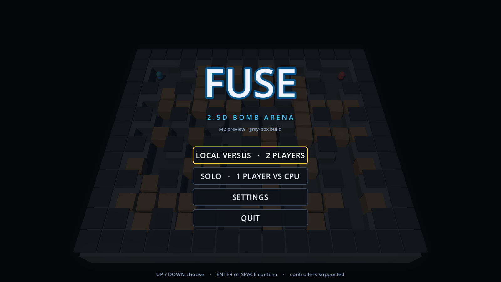
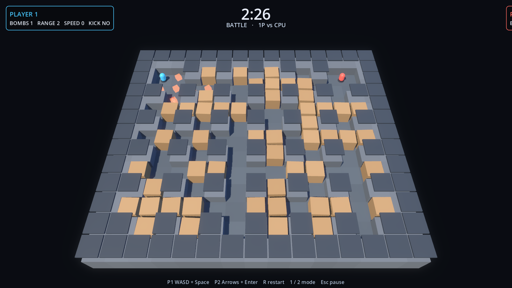

# FUSE

Working title for a modern **2.5D bomb-arena action game** (Atomic Bomberman-inspired),
built in **Godot 4.7.2**. Windows first, Android after.

> **Status: M2 — local versus front end (verified).**
> Title screen with a live AI attract match → mode select → best-of series → results →
> rematch. Pause menu, persisted settings, and event-driven procedural sound effects are
> in. Characters, bombs, fire and pickups are still **code-built grey-box meshes** with
> procedural motion — there is no character art, no music and no Arabic localization yet.
> See [`docs/PROGRESS.md`](docs/PROGRESS.md) for exactly what exists and what does not.



*Real captured frame from `--capture` mode — title panel over a running AI attract match.*



*Real captured frame from `--shot` mode, tick 362: two fighters, an armed bomb, six blast
tiles and one pickup.*

---

## Requirements

- Godot **4.7.2** (standard build, not .NET)
- Windows 10/11 for development
- Blender 4.x only when working on real art (not needed until M3)

The engine used by this project is installed at:

```
%LOCALAPPDATA%\Programs\Godot\4.7.2\Godot_v4.7.2-stable_win64.exe
```

Use the **console** executable for command-line work:

```
%LOCALAPPDATA%\Programs\Godot\4.7.2\Godot_v4.7.2-stable_win64_console.exe
```

The GUI executable does not attach stdout or return exit codes to PowerShell, which
breaks test automation.

## Play

```powershell
cd "C:\Users\ALMASA\OneDrive\Documents\Default Project\fuse"
& "$env:LOCALAPPDATA\Programs\Godot\4.7.2\Godot_v4.7.2-stable_win64.exe" --path .
```

The game boots to the title screen; an AI-vs-AI match plays behind the menu as an
attract demo. Menus are fully keyboard and controller navigable.

### Menus

| Input | Action |
| --- | --- |
| `Up` / `Down` (or D-pad) | Move selection |
| `Left` / `Right` | Adjust a volume slider |
| `Enter` / `Space` (or `A`) | Confirm |
| `Esc` | Leave settings / pause |

Title actions: **LOCAL VERSUS** (2 players, one keyboard or two pads), **SOLO**
(1 player vs CPU), **SETTINGS**, **QUIT**.

### Match

| Input | Action |
| --- | --- |
| `W A S D` + `Space` | Player 1 move / drop bomb |
| Arrow keys + `Enter` | Player 2 move / drop bomb |
| Gamepad left stick or D-pad + `A`/`X` | Player 1 or 2 (pad order) |
| `1` / `2` | One player vs CPU / two players local (restarts the series) |
| `R` | Restart the current round |
| `Esc` | Pause menu (resume / restart round / quit to title) |

A series is **best of 3** by default (1 or 5 selectable in settings). Draws award no
point but consume a round, and the round limit closes a series that cannot be decided.

The CPU opponent reads the same public simulation state a client sees and issues
ordinary move/bomb commands. It plans timed escape routes, so it will not walk along
its own blast lane.

## Settings and audio

**SETTINGS** lives on the title screen:

- master volume and SFX volume (applied live, persisted)
- series length (best of 1 / 3 / 5)
- fullscreen toggle
- values are stored in `user://settings.json`

The loader treats the file as untrusted: missing keys fall back to defaults, volumes are
clamped to `0..1`, unsupported series lengths and unknown locales are ignored, and
corrupt JSON is discarded rather than crashing the game.

All sound is **synthesised at runtime** (`src/audio/sfx_library.gd`) — placement thud,
crate break, explosion, pickup chime, hit and win jingle — and played through a 16-voice
pool driven by simulation events. There are no audio files and no music track yet; M3
replaces the placeholders with designed sound while keeping the event wiring.

## Run the tests

```powershell
cd "C:\Users\ALMASA\OneDrive\Documents\Default Project\fuse"
$godot = "$env:LOCALAPPDATA\Programs\Godot\4.7.2\Godot_v4.7.2-stable_win64_console.exe"
& $godot --headless --path . --script res://tests/run_tests.gd
```

Expected: `55 test(s), 313 assertion(s), 0 failure(s)` then `PASS` and exit code `0`.
Add `-- --verbose` to list each test by name.

End-to-end menu test (real scene tree, synthesized key events, real AI matches to a
finished series):

```powershell
& $godot --headless --path . --script res://tools/ui_flow_test.gd
```

Expected: `UI flow: 47 check(s)`, `PASS`, exit code `0`. It covers title → settings
(volume + series changes, plus ESC-to-close), title → 1P match, pause/resume, a genuine
AI-decided round, round 2, a decided series, rematch, and quit back to title.

Frame smoke test (boots the real scene for 300 frames, no errors allowed):

```powershell
& $godot --headless --path . --quit-after 300
```

Architecture guard (fails if `src/core` ever touches nodes, input, audio or the clock):

```powershell
powershell -ExecutionPolicy Bypass -File tools/check_core_boundaries.ps1
```

AI self-play smoke test (proves a match actually resolves; prints bombs, explosions,
crates, pickups, eliminations):

```powershell
& $godot --headless --path . --script res://tools/ai_selfplay.gd
# optional diagnostics:  ... --script res://tools/ai_selfplay.gd -- trace
```

## Screenshots

Shot mode fast-forwards a seeded AI-vs-AI match, waits for a frame that contains
bombs, fire and at least two living fighters, then writes a PNG and quits:

```powershell
New-Item -ItemType Directory build\shots -Force | Out-Null
$shot = (Resolve-Path build\shots).Path + "\m1.png"
& $godot --path . --resolution 1600x900 -- --shot=$shot --shot-ticks=360 --seed=4242
```

Menu capture mode renders a specific screen after a few frames:

```powershell
$out = (Resolve-Path build\shots).Path + "\m2-settings.png"
& $godot --path . --resolution 1600x900 -- --capture=$out --capture-screen=settings
```

`--capture-screen` accepts `title`, `settings`, `pause` or `series`.
Shot flags (after `--`): `--shot=<path>`, `--shot-ticks=<n>` (default 480),
`--seed=<n>`. Capture flags: `--capture=<path>`, `--capture-screen=<name>`,
`--capture-after=<frames>` (default 24).

Two PowerShell helpers inspect a capture without opening it:

```powershell
powershell -ExecutionPolicy Bypass -File tools/preview_png.ps1 build\shots\m2-title.png 100 34
powershell -ExecutionPolicy Bypass -File tools/analyze_png.ps1 build\shots\m2-settings.png
```

`preview_png.ps1` prints an ASCII luminance map; `analyze_png.ps1` reports accent
colours (player/fire/text) and their screen positions.

## Layout

| Path | Purpose |
| --- | --- |
| `src/core/` | Pure simulation: grid, rules, arena, match state, events. No nodes, scenes, audio, input, clock or `await`. |
| `src/render/` | Grey-box 3D views (arena, player, bomb, blast, pickup), palette/materials, camera rig. Read-only over sim state. |
| `src/input/` | Keyboard/gamepad → `{dir, bomb}` commands. The only device-aware layer. |
| `src/ai/` | Deterministic command-emitting opponent (normal match participant). |
| `src/app/` | Game shell: app flow, settings persistence, fixed-tick driver, lighting, shot/capture modes. |
| `src/audio/` | Procedural SFX synthesis and an event → voice-pool director. |
| `src/ui/` | HUD plus menu screens (title, pause, series, settings) and shared menu styling. |
| `scenes/` | `main.tscn` entry scene. Lobby/adventure scenes arrive M3–M4. |
| `tests/` | Headless tests and golden state hashes. |
| `tools/` | Self-play, UI flow test, golden-hash dump, core boundary guard, PNG analysis. |
| `docs/` | Technical design, progress log, screenshots. |
| `src/online/`, `server/` | Prediction/reconciliation and authoritative server (M5, not present yet). |

## Docs

- [`docs/TECHNICAL_DESIGN.md`](docs/TECHNICAL_DESIGN.md) — stack decision, architecture, netcode, roadmap, risks.
- [`docs/PROGRESS.md`](docs/PROGRESS.md) — verified status, test results, next steps.

## Related project

`../blast-arena/` is an earlier **web** prototype (React Three Fiber + Colyseus). It is
untouched and kept as a reference for rules, match flow, and networking behavior. It is
not the codebase for this game.
